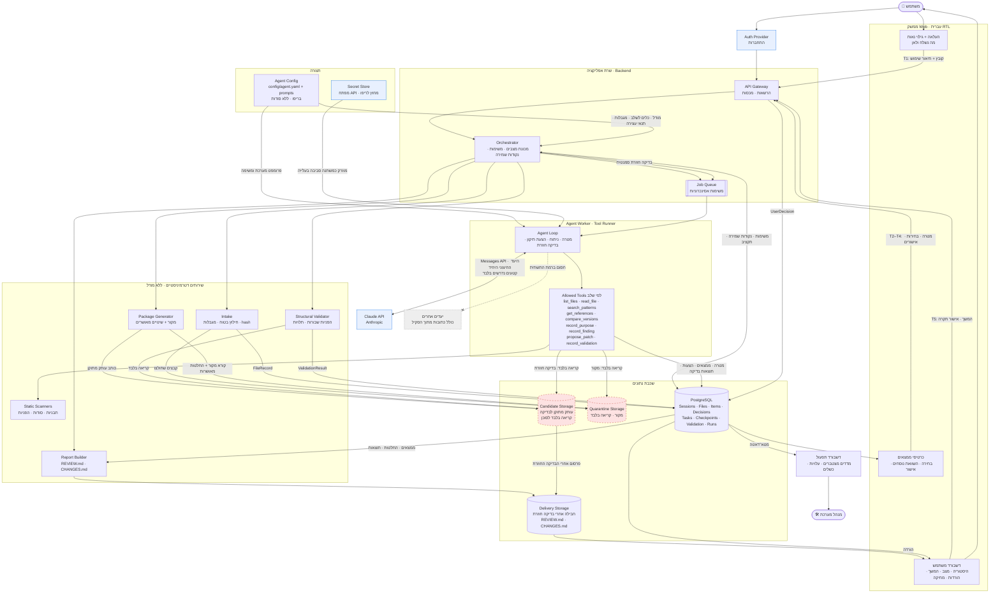
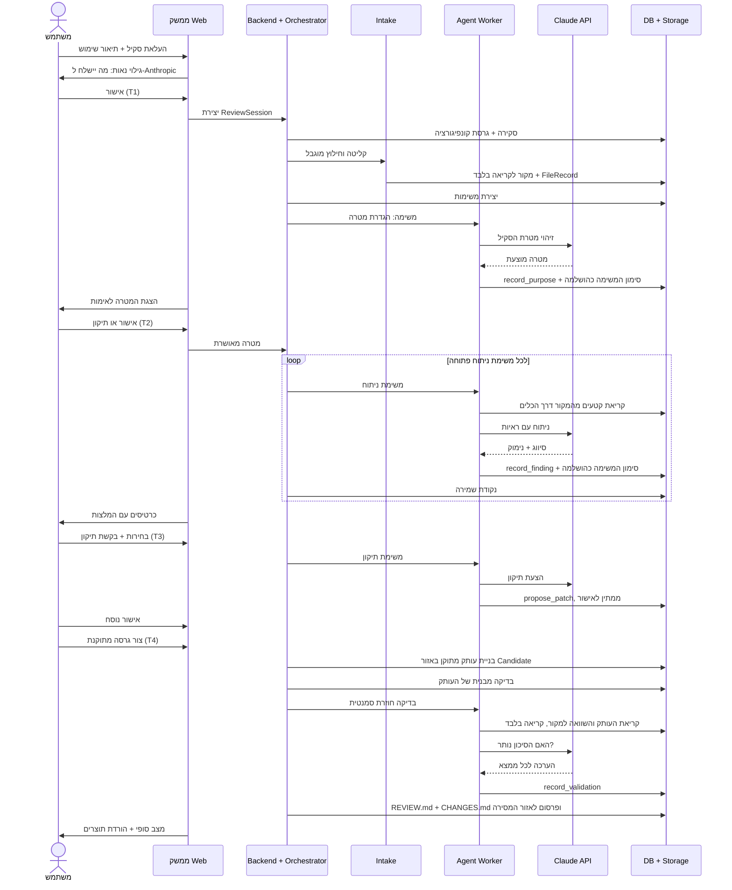
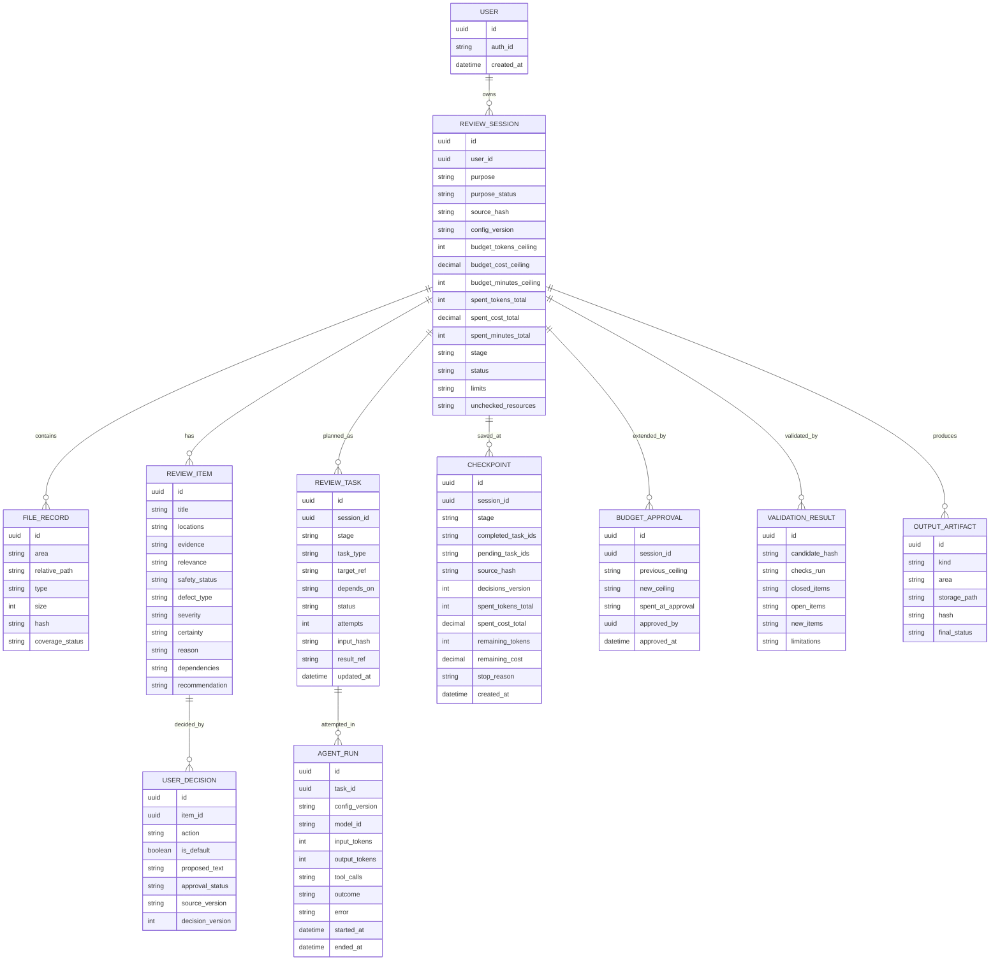
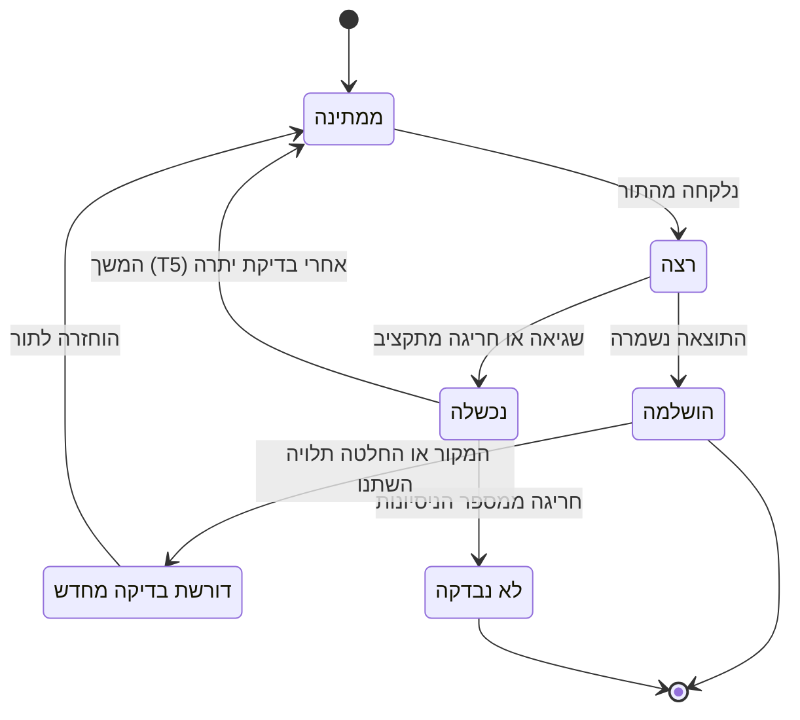
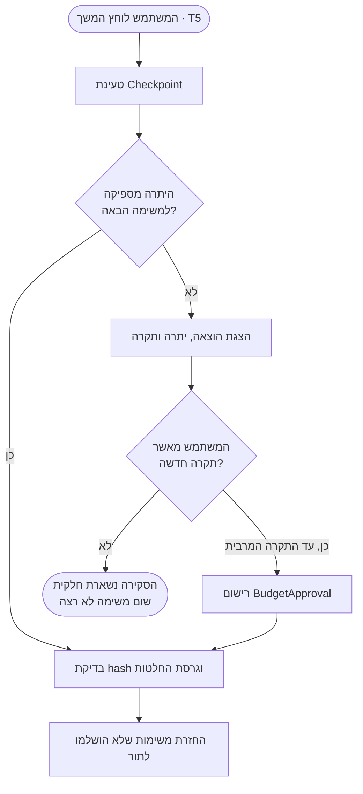

# Skill Review & Repair Agent — Architecture

גרסה: 0.4 · תאריך: 19.10.2026 · סטטוס: תכנון בלבד, ללא מימוש או פריסה
מסמכים קשורים: [SPEC.md](SPEC.md) · [README.md](README.md)

## 1. מטרת המסמך ומצב העבודה

**מצב במטלה 6:** שאלות 3–4 מתועדות בתכנון. שאלה 4 נענית במסמך זה. שאלה 5 (משימת רשות: בניית סוכן מקצה לקצה) מתוכננת: תרחיש ההדגמה מוגדר ב־SPEC.md, סעיף 17, ודרך האימות שלו בסעיף 13 כאן. היא טרם מומשה או הוגשה.

**תפקיד המסמך:** איך המערכת תתמוך בדרישות של SPEC.md. הדרישות עצמן, חוויית המשתמש ותנאי הקבלה נמצאים ב־SPEC.md ואינם חוזרים כאן.

המסמך עונה על שלוש שאלות:

1. **מה גורם לסוכן לרוץ?** אילו אירועים מפעילים אותו.
2. **מאיפה מגיע המידע ולאן הוא הולך?** תרשים זרימה מהמשתמש, דרך הסוכן ועד התוצרים.
3. **מה מרכיבי המערכת?** ממשק, שרת, סוכן, קונפיגורציה, בסיס נתונים, אחסון קבצים ודשבורדים.

## 2. רישום החלטות

זה המקום היחיד שבו מוגדרים מזהי ההחלטות. SPEC.md ו־README.md מפנים אליו.

### החלטות שהתקבלו

| מזהה | נושא | החלטה | מקור |
|---|---|---|---|
| D1 | ספק המודל | Anthropic | נקבע במטלה |
| D2 | אופן ההרצה | Claude API (Messages) עם Tool Runner, בשרת שלנו. לא Managed Agents | החלטת תכנון |
| D3 | זהות | התחברות עם חשבון | החלטת תכנון |
| D4 | דשבורדים | דשבורד משתמש + דשבורד תפעול | החלטת תכנון |
| D5 | קלט ב־MVP | העלאת SKILL.md, תיקייה או ZIP, ללא הרצה. קישור למאגר בהמשך | SPEC |
| D6 | קונפיגורציה | קובץ קונפיגורציה של הסוכן בריפו, ללא מפתחות או סודות | דרישת מטלה |
| D7 | תוצרים | חבילה מתוקנת, REVIEW.md ו־CHANGES.md, להורדה בלבד ורק אחרי בדיקה חוזרת | SPEC |
| D8 | תקציב בהמשך | "המשך" בודק יתרה ואינו מאפס את ההוצאה המצטברת. כשהיתרה אינה מספיקה, נדרש אישור מפורש להגדלת התקרה לפני שממשיכים | החלטת תכנון |
| D9 | הגבלת רשת | ה־Agent Worker מתקשר רק עם בסיס הנתונים, האחסון, התור ו־Claude API. כל יעד אחר חסום, לרבות כתובות מתוך הסקיל | החלטת תכנון |

**נימוק ל־D2:** הקליטה, החילוץ והכלים נשארים בקוד דטרמיניסטי שלנו, ו־Claude מקבל רק כלי קריאה וניתוח. כך לא סומכים על המודל לבדו כדי לאכוף גבולות גישה (SPEC, סעיף 11). ב־Managed Agents, ‏Anthropic מריצה את הלולאה ומארחת sandbox עם bash והרצת קוד. אצלנו התוכן שנבדק אינו מהימן ואסור בהרצה, ולכן עדיף שהכלים יוגדרו על ידינו. אפשר לשקול מעבר בעתיד.

### החלטות פתוחות

| מזהה | נושא | המלצה נוכחית |
|---|---|---|
| O1 | מזהה המודל, הגרסה ורמת המאמץ | ייקבע לאחר אימות זמינות ובדיקת איכות ועלות |
| O2 | ספקי אירוח, בסיס נתונים, אחסון ו־Auth | — |
| O3 | מדיניות שמירת נתונים ומחיקה, כולל תנאי השמירה אצל Anthropic | — |
| O4 | ספי גודל, מספר קבצים ועומק לארכיון | — |
| O5 | ערכי התקרות לסקירה, התקרה המרבית להגדלה באישור, המגבלות למשימה ומספר הניסיונות המרבי | — |
| O6 | גודל משימת ניתוח: קובץ בודד או קבוצת קבצים קשורים | קבוצת קבצים שמפנים זה לזה |
| O7 | פורמטי קוד נתמכים לניתוח | — |
| O8 | נוסח הגילוי הנאות לפני השליחה ל־Anthropic | — |
| O9 | הסתרת סודות גם לפני השליחה למודל, ולא רק בדוח ובתצוגה | להסתיר |
| O10 | תוכן דשבורד התפעול | מטא־דאטה מצטברת בלבד, ללא תוכן סקילים |
| O11 | שימוש ב־Files API של Anthropic | לא ב־MVP; הסוכן מקבל קטעים דרך הכלים |
| O12 | שם הסוכן | — |
| O13 | שם ופורמט קובץ הקונפיגורציה | `config/agent.yaml` + קובצי פרומפט בתיקיית `prompts/` |
| O14 | תקציב ומספר הרצות בתשלום להדגמה ולבדיקות (שאלה 5) | — |
| O15 | שפת מימוש, ספריות וסביבת פיתוח | — |

המלצה אינה החלטה. בכל מקום במסמכים שבו מופיע נושא פתוח, הוא מסומן במזהה ה־O שלו.

## 3. טריגרים: מה מפעיל את הסוכן

הסוכן אינו רץ ברקע באופן קבוע. כל הרצה נובעת מפעולה מפורשת של המשתמש בממשק (SPEC, סעיף 4).

| # | טריגר | מה קורה במערכת | שלבים ב־SPEC |
|---|---|---|---|
| T1 | העלאת סקיל ואישור השליחה | נוצרת ReviewSession עם גרסת הקונפיגורציה, Intake רץ, ומשימות הגדרת המטרה והניתוח נכנסות לתור | 1–3 |
| T2 | אימות או תיקון מטרת הסקיל | משימות הסיווג ממשיכות לפי המטרה המאושרת | 2–3 |
| T3 | בקשה לנוסח מתוקן בכרטיס | משימת תיקון אחת; התוצאה נשמרת כהצעה בלבד | 5 |
| T4 | "צור גרסה מתוקנת" אחרי שכל החלקים הוכרעו | Package Generator בונה את העותק באזור Candidate, ואחריו בדיקה מבנית ובדיקה סמנטית חוזרת על העותק עצמו | 7–8 |
| T5 | "המשך" בסקירה שנעצרה | ה־Orchestrator טוען את נקודת השמירה ובודק את יתרת התקציב. אם היא אינה מספיקה, הוא ממתין לאישור תקרה חדשה. אחר כך הוא מחזיר לתור רק משימות שלא הושלמו (סעיף 9) | כל שלב שנעצר (SPEC, §14) |

**מה לא מפעיל את הסוכן:** קישורים, הוראות התקנה או הוראות כלשהן שבתוך הסקיל (SPEC, סעיף 10). אין ב־MVP הפעלה מתוזמנת או Webhook. קישור למאגר הוא טריגר עתידי (D5).

## 4. תרשים המערכת וזרימת המידע

אזורי האחסון המסומנים באדום מכילים תוכן סקיל, ולכן נחשבים לא מהימנים. זה נכון גם לעותק המתוקן, כי הוא נבנה מתוכן המקור. ה־Agent Worker רשאי לתקשר רק עם בסיס הנתונים, האחסון, התור ו־Claude API (D9). כל יעד אחר חסום ברמת התשתית, לרבות כתובות שמופיעות בסקיל.



### איך לקרוא את התרשים

1. **תצורה:** בעליית השרת נטען קובץ הקונפיגורציה ונבדק מול סכמה. המפתח ל־Claude API מוזרק ל־Agent Worker כמשתנה סביבה בעלייה, מתוך Secret Store, ואינו נמצא בריפו (סעיף 7).
2. **כניסה:** המשתמש מתחבר, מעלה את הסקיל ומאשר את השליחה (T1).
3. **קליטה דטרמיניסטית:** Intake מחלץ את הארכיון בתוך אזור ההסגר, חוסם נתיבים חורגים וקישורים סמליים, ושומר FileRecord עם hash. אין כאן מודל.
4. **ניתוח:** ה־Orchestrator מפרק את העבודה למשימות, שומר אותן בבסיס הנתונים ושולח אותן לתור. ה־Agent Worker מריץ לולאה מול Claude API עם הפרומפט והכלים של אותו שלב בלבד. הוא מתקשר רק עם בסיס הנתונים, האחסון, התור ו־Claude API (D9).
5. **אינטראקציה:** הממצאים מוצגים ככרטיסים. כל בחירה ואישור, כולל ברירת המחדל "להשאיר", נשמרים כ־UserDecision (T2–T3).
6. **יצירה:** בלחיצה על "צור גרסה" (T4), Package Generator בונה עותק חדש באזור Candidate מהמקור ומההחלטות המאושרות בלבד.
7. **בדיקה חוזרת על התוצר בפועל:** Structural Validator בודק הפניות ותלויות, והסוכן מבצע בדיקה סמנטית. בשלב הזה בלבד כלי הקריאה פתוחים גם לאזור Candidate, בקריאה בלבד.
8. **מסירה:** אחרי הבדיקה החוזרת, החבילה ודוחות REVIEW.md ו־CHANGES.md עוברים לאזור המסירה עם המצב הסופי. דשבורד התפעול מקבל מטא־דאטה (היקף התצוגה: O10).

## 5. רצף הפעולות לאורך סקירה אחת



## 6. מרכיבי המערכת

| מרכיב | תפקיד | משתמש במודל? |
|---|---|---|
| ממשק Web | העלאה, גילוי נאות, כרטיסים, השוואת נוסחים, דשבורד משתמש. עברית RTL; קוד ונתיבים LTR | לא |
| Auth Provider | התחברות וזיהוי המשתמש (D3; ספק: O2) | לא |
| API Gateway | אימות הרשאות, הפרדה בין משתמשים, מכסות | לא |
| Agent Config | מודל, פרומפטים, כלים לשלב, מגבלות ותנאי עצירה (סעיף 7) | — |
| Secret Store | מפתח ה־API, מחוץ לריפו. מוזרק ל־Agent Worker כמשתנה סביבה בעלייה, כך שה־Worker אינו פונה אליו ברשת | — |
| Orchestrator | מנהל את מצב הסקירה, מפרק כל שלב למשימות, שומר נקודות שמירה, בודק יתרת תקציב לפני המשך ומעביר לסוכן רק את הכלים של השלב | לא |
| Job Queue | משימות שאורכות דקות רצות ברקע; הממשק מתעדכן בהתקדמות | לא |
| Intake | חילוץ בטוח, מגבלות גודל ועומק (O4), hash, סימון קבצים לא נתמכים | לא |
| Static Scanners | איתור תבניות סיכון, סודות, הפניות ותלויות, במקור ובעותק המתוקן. רץ כספרייה בתוך התהליך, ללא קריאות רשת | לא |
| Agent Worker | לולאת Tool Runner מול Claude: הגדרת מטרה, סיווג, הסברים, הצעות תיקון, בדיקה סמנטית חוזרת. תקשורת רשת: בסיס הנתונים, האחסון, התור ו־Claude API בלבד (D9) | כן |
| Package Generator | בניית העותק המתוקן באזור Candidate מהמקור ומההחלטות המאושרות בלבד | לא |
| Structural Validator | בדיקת הפניות שבורות ותלויות שנותקו בעותק המתוקן | לא |
| Report Builder | הפקת REVIEW.md ו־CHANGES.md מבסיס הנתונים | לא |
| PostgreSQL | נתונים מובנים, משימות ונקודות שמירה (סעיפים 8–9). PostgreSQL הוא דוגמה לסוג הרכיב; הספק: O2 | — |
| Quarantine Storage | המקור, לקריאה בלבד ולכל משתמש בנפרד | — |
| Candidate Storage | העותק המתוקן לפני מסירה; רק Package Generator כותב אליו | — |
| Delivery Storage | התוצרים להורדה, אחרי הבדיקה החוזרת | — |
| דשבורד תפעול | מדדים למנהל (היקף: O10) | לא |

### כלי הסוכן

הסוכן מקבל רשימה סגורה של כלים. אין לו bash, הרצת קוד, גישה לרשת או web fetch. בכל משימה ה־Orchestrator מעביר לו רק את הכלים שמוגדרים לשלב בקונפיגורציה, ורק מתוך הרשימה הזו.

| כלי | פעולה | גישה | שלבים |
|---|---|---|---|
| `list_files` | מפת הקבצים | קריאה: `source`; ‏`candidate` בבדיקה חוזרת | הגדרת מטרה, בדיקה, בדיקה חוזרת |
| `read_file` | קריאת קובץ או טווח שורות (הסתרת סודות לפני שליחה למודל: O9) | קריאה: `source`; ‏`candidate` בבדיקה חוזרת | כל ארבעת השלבים |
| `search_patterns` | הפעלת הסורקים הדטרמיניסטיים על אזור נבחר | קריאה: `source`; ‏`candidate` בבדיקה חוזרת | בדיקה, בדיקה חוזרת |
| `get_references` | גרף הפניות ותלויות, כולל הפניות שבורות | קריאה: `source`; ‏`candidate` בבדיקה חוזרת | בדיקה, תיקון, בדיקה חוזרת |
| `compare_versions` | השוואת קובץ במקור לקובץ בעותק המתוקן | קריאה: `source` + `candidate` | בדיקה חוזרת |
| `record_purpose` | שמירת המטרה המוצעת לאימות המשתמש | כתיבה ל־DB בלבד | הגדרת מטרה |
| `record_finding` | שמירת ReviewItem לפי סכמה קבועה | כתיבה ל־DB בלבד | בדיקה |
| `propose_patch` | שמירת נוסח מוצע; לא מוחל בלי אישור | כתיבה ל־DB בלבד | תיקון |
| `record_validation` | תוצאה לכל ממצא מקורי: נסגר, נותר, או ממצא חדש | כתיבה ל־DB בלבד | בדיקה חוזרת |

כללים לכל הכלים:
- `source` ו־`candidate` הם שמות של אזורים, לא נתיבים. הכלי ממיר אותם לנתיב של הסשן הנוכחי ובודק שהנתיב היחסי לא יוצא מהאזור.
- אף כלי לא כותב קבצים. כתיבה לאזורי האחסון נעשית רק על ידי Intake, Package Generator ו־Report Builder.
- הגישה ל־`candidate` נפתחת רק בשלב הבדיקה החוזרת.
- האכיפה בקוד. הקונפיגורציה יכולה לצמצם את הרשימה, לא להרחיב אותה.

## 7. קונפיגורציית הסוכן

דרישת D6 מפורטת ב־SPEC.md, סעיף 12. כאן מתואר איך היא ממומשת. שם הקובץ והפורמט הם המלצה (O13).

### מבנה מוצע

הערכים המסומנים `<TBD>` תלויים בהחלטות פתוחות. אין כאן שום ערך סודי.

```yaml
config_version: "0.1.0"
agent_name: "<TBD>"                 # O12

model:
  provider: anthropic               # D1
  model_id: "<TBD>"                 # O1
  effort: "<TBD>"                   # O1 — רק אם המודל שנבחר תומך
  max_output_tokens: <TBD>          # O5

secrets:
  api_key_env: ANTHROPIC_API_KEY    # שם המשתנה בלבד; הערך לא נשמר בריפו

prompts:
  system: prompts/system.md

stages:
  detect_purpose:
    prompt: prompts/tasks/detect_purpose.md
    tools: [list_files, read_file, record_purpose]
    read_areas: [source]
  analyze:
    prompt: prompts/tasks/analyze.md
    tools: [list_files, read_file, search_patterns, get_references, record_finding]
    read_areas: [source]
  propose_fix:
    prompt: prompts/tasks/propose_fix.md
    tools: [read_file, get_references, propose_patch]
    read_areas: [source]
  revalidate:
    prompt: prompts/tasks/revalidate.md
    tools: [list_files, read_file, search_patterns, get_references, compare_versions, record_validation]
    read_areas: [source, candidate]

limits:                             # O5
  per_task:
    tokens: <TBD>
  per_review:                       # תקרות מצטברות; לא מתאפסות בהמשך (D8)
    tokens: <TBD>
    cost_usd: <TBD>
    processing_minutes: <TBD>
  max_approved_ceiling:             # התקרה המרבית שאליה מותר להגדיל באישור המשתמש
    tokens: <TBD>
    cost_usd: <TBD>
    processing_minutes: <TBD>

stop_conditions:                    # O5
  max_agent_turns_per_task: <TBD>
  max_tool_calls_per_task: <TBD>
  max_attempts_per_task: <TBD>
  on_budget_exceeded: checkpoint_and_mark_partial
  on_tool_error: retry_then_checkpoint
  on_model_error_or_refusal: checkpoint_and_mark_partial

resume:                             # D8 — קבוע; ערך אחר הוא שגיאה
  required_remaining: limits.per_task
  on_insufficient_budget: require_user_ceiling_approval
```

### כללי טעינה

- הקובץ נבדק מול סכמה בעליית השרת. קובץ לא תקין, שדה חובה חסר או ערך `<TBD>` מונעים התחלת סקירות.
- שמות כלים חייבים להיות מתוך הרשימה בסעיף 6. כלי לא מוכר או אזור לא מוכר הם שגיאה, לא התעלמות.
- הגישה ל־`candidate` מותרת רק ב־`revalidate`. הקוד אוכף זאת גם אם הקונפיגורציה מנסה אחרת.
- בדיקת היתרה והדרישה לאישור תקרה (D8) נאכפות בקוד. הקונפיגורציה קובעת רק את ערכי המגבלות והתקרה המרבית.
- רשימת יעדי הרשת המותרים (D9) מוגדרת בתשתית, לא בקובץ הזה, ואי אפשר להרחיב אותה דרכו.
- כל ReviewSession שומרת את `config_version`, וכל AgentRun שומר גם את מזהה המודל בפועל.

### סודות

- המפתח ל־Claude API מוזרק מ־Secret Store למשתנה הסביבה ששמו מופיע בקונפיגורציה, בעליית ה־Agent Worker.
- בריפו יהיו רק `.env.example` עם שמות משתנים ללא ערכים, ו־`.gitignore` שמחריג את `.env`.
- הלוגים, הדוחות והדשבורדים לא מציגים את המפתח.
- לפני הגשה תתבצע סריקת סודות על הריפו, למשל באמצעות gitleaks.

## 8. שמירת נתונים

### בסיס הנתונים



הישויות ב־SPEC.md, סעיף 13, ממופות כך:
- ReviewSession, ‏FileRecord, ‏ReviewItem, ‏UserDecision ו־ValidationResult מופיעות כאן בשמן.
- "התקדמות" ממומשת ב־ReviewTask וב־Checkpoint (סעיף 9).
- "תקרות התקציב וההוצאה המצטברת" הן שדות ב־ReviewSession.
- "אישור הגדלת תקרה" ממומש ב־BudgetApproval: התקרה הקודמת והחדשה, ההוצאה בזמן האישור, מי אישר ומתי (D8).

טבלאות עזר:
- **User:** בעלות על סקירות (D3).
- **AgentRun:** תיעוד של כל ניסיון להריץ משימה: גרסת קונפיגורציה, מודל, טוקנים, קריאות כלים ותוצאה. משמש לדשבורד התפעול ולאימות ההדגמה. הוא לבדו לא מספיק כדי להמשיך מנקודת עצירה.
- **OutputArtifact:** מיקום התוצרים, האזור שבו הם נמצאים ומצבם הסופי.

### אחסון קבצים

| אזור | תוכן | מי כותב | מי קורא |
|---|---|---|---|
| Quarantine | המקור כפי שהועלה, אחרי חילוץ מוגבל | Intake בלבד, פעם אחת | כלי הסוכן, הסורקים ו־Package Generator, בקריאה בלבד |
| Candidate | העותק המתוקן לפני מסירה | Package Generator בלבד | כלי הסוכן בבדיקה החוזרת, הסורקים ו־Structural Validator, בקריאה בלבד |
| Delivery | החבילה אחרי הבדיקה החוזרת, REVIEW.md ו־CHANGES.md | Orchestrator ו־Report Builder | הבעלים בלבד, להורדה |

כל האזורים מופרדים לפי משתמש וסשן, ואינם משותפים בין משתמשים. מחיקת סקירה מוחקת את שלושת האזורים ואת הרשומות שלה (מדיניות השמירה: O3).

## 9. שמירת התקדמות והמשך מנקודת עצירה

מממש את SPEC.md, סעיף 14. רישום טוקנים ותוצאת הרצה מראה מה קרה, אבל לא מאפשר להמשיך. לכן כל שלב מפורק למשימות, וההתקדמות נשמרת ברמת המשימה.

### פירוק למשימות

| שלב | משימות | מבצע |
|---|---|---|
| הגדרת מטרה | זיהוי מטרת הסקיל | סוכן |
| בדיקה | ניתוח קובץ או קבוצת קבצים (O6); בדיקת תלות או הפניה | סוכן |
| תיקון | הכנת נוסח מוצע לכרטיס אחד | סוכן |
| יצירה | בניית העותק המתוקן | Package Generator |
| בדיקה חוזרת | בדיקה מבנית; בדיקה סמנטית של ממצא מקורי אחד; סריקה של קובץ שהשתנה | Structural Validator, סוכן |
| מסירה | הפקת REVIEW.md ו־CHANGES.md ופרסום | Report Builder, Orchestrator |

### מצבי משימה



### מה נשמר ומתי

- **בסוף כל משימה:** התוצאה וסימון המשימה כ"הושלמה" נשמרים באותה טרנזקציה. התוצאה מקושרת למזהה המשימה, כך שהרצה חוזרת מחליפה תוצאה קיימת ולא יוצרת כפילות.
- **בסוף כל משימה ובכל עצירה:** נשמר Checkpoint עם השלב, המשימות שהושלמו והמשימות שנותרו, ה־hash של המקור, גרסת ההחלטות, ההוצאה המצטברת והיתרה, וסיבת העצירה.
- **הוצאה מצטברת:** בסוף כל AgentRun ההוצאה שלו נוספת לסכום ב־ReviewSession. הסכום אינו מתאפס בעצירה, בהמשך או בהגדלת תקרה.
- **סיבות עצירה:** לפי `stop_conditions` בקונפיגורציה — חריגה מתקציב טוקנים, עלות או זמן; חריגה ממספר סבבים או קריאות כלים; כשל כלי; כשל או סירוב של שירות המודל אחרי ניסיונות חוזרים. המתנה להכרעת המשתמש אינה עצירה.

### תהליך ההמשך (T5)

1. ה־Orchestrator טוען את ה־Checkpoint האחרון של הסשן.
2. **בדיקת יתרה (D8):** היתרה היא התקרה פחות ההוצאה המצטברת, לכל סוג תקציב. ההוצאה אינה מתאפסת. אם היתרה קטנה מהמגבלה למשימה הבאה, ה־Orchestrator מציג למשתמש את ההוצאה, היתרה והתקרה, ושום משימה אינה רצה. העבודה ממשיכה רק אחרי אישור מפורש של תקרה חדשה, שאינה עולה על `max_approved_ceiling`. האישור נשמר ב־BudgetApproval. בלי אישור, הסקירה נשארת "חלקית".
3. הוא בודק שה־hash של המקור לא השתנה. אם השתנה, האישורים והתוצאות של החלקים שהשתנו מבוטלים (SPEC, סעיף 13), והמשימות התלויות חוזרות ל"ממתינה".
4. הוא בודק את גרסת ההחלטות. משימות שתלויות בהחלטה שהשתנתה מסומנות "דורשת בדיקה מחדש".
5. משימות שהיו במצב "רצה" בזמן העצירה חוזרות ל"ממתינה". תוצאה חלקית שלהן לא נשמרה, כי השמירה נעשית רק בסיום.
6. רק משימות ממתינות ומשימות שנכשלו נכנסות לתור. משימות שהושלמו אינן רצות שוב.
7. הסוכן מקבל סיכום מצב קצר שנבנה מבסיס הנתונים (מטרה, ממצאים רלוונטיים, המשימה הנוכחית), ולא את היסטוריית השיחה הקודמת (SPEC, סעיף 11).



משימה שחרגה מ־`max_attempts_per_task` מסומנת "לא נבדקה". הקבצים שלה מסומנים ככאלה שלא נבדקו, והסקירה מסתיימת במצב "חלקי". בדשבורד המשתמש מוצגים מה הושלם, מה נותר וכפתור "המשך".

## 10. מה נעשה עם הפלט

| פלט | מה קורה איתו | מי רואה |
|---|---|---|
| מטרה מוצעת | נשמרת בבסיס הנתונים ומוצגת בממשק לאימות | המשתמש |
| כרטיסי ממצאים והמלצות | נשמרים בבסיס הנתונים ומוצגים בממשק | המשתמש |
| נוסחים מוצעים והשוואות | נשמרים בבסיס הנתונים ומוצגים בממשק עד לאישור או לדחייה | המשתמש |
| עותק מתוקן לפני בדיקה | נשמר באזור Candidate ונבדק. אינו זמין להורדה בשלב הזה | המערכת והסוכן, בקריאה בלבד |
| חבילת סקיל מתוקנת | עוברת לאזור המסירה אחרי הבדיקה החוזרת, עם המצב הסופי, וזמינה להורדה | המשתמש |
| REVIEW.md | נוצר מבסיס הנתונים, נשמר באזור המסירה וזמין להורדה | המשתמש |
| CHANGES.md | נוצר מבסיס הנתונים, נשמר באזור המסירה וזמין להורדה | המשתמש |
| מצב סופי (הושלם / הושלם עם ממצאים פתוחים / חלקי) | נשמר בבסיס הנתונים ומוצג במסך הסיום ובדשבורד המשתמש | המשתמש |
| התקדמות ומשימות שנותרו | נשמרות בבסיס הנתונים ומוצגות בדשבורד המשתמש כשהסקירה נעצרה | המשתמש |
| הוצאה מצטברת, יתרה ואישורי הגדלת תקרה | נשמרים בבסיס הנתונים ומוצגים בדשבורד המשתמש | המשתמש |
| מדדי שימוש, עלויות וכשלים | נאספים מ־AgentRun ומוצגים בדשבורד התפעול | מנהל (היקף: O10) |

הפלט **לא נשלח** לשום יעד חיצוני, לא מותקן ולא מופעל (D7). המשתמש מוריד אותו ומחליט מה לעשות בו.

## 11. דשבורדים (D4)

**דשבורד משתמש**
- רשימת סקירות עם תאריך, שם הסקיל ומצב.
- כניסה לסקירה פתוחה, כולל מה הושלם ומה נותר, וכפתור "המשך" (T5).
- התקציב שנוצל והיתרה, ובקשה לאישור תקרה חדשה כשהיתרה אינה מספיקה (D8).
- הורדת תוצרים לפי מצב הבדיקה ומגבלותיה.
- מחיקת סקירה וכל הקבצים שלה.

**דשבורד תפעול**
- מספר סקירות לפי מצב סופי.
- התפלגות ממצאים לפי חומרה וסוג ליקוי.
- זמן ועלות API ממוצעים לסקירה, לפי גרסת קונפיגורציה ומודל.
- כשלי כלים, חריגות תקציב, הגדלות תקרה, משימות שלא נבדקו וסקירות חלקיות.

היקף התצוגה פתוח (O10). ההמלצה: מטא־דאטה מצטברת בלבד, בלי תוכן סקילים או קטעי ראיה.

## 12. גבולות אמון ואבטחה

| דרישה (SPEC) | איפה נאכפת בארכיטקטורה |
|---|---|
| העלאה לא מפעילה קוד, קישורים או הוראות (§10) | Intake מחלץ בלבד; לסוכן אין כלי הרצה או רשת |
| תוכן הסקיל לא משנה את הוראות הבודק (§10) | התוכן מגיע למודל כתוצאת כלי, מסומן כחומר לבדיקה; הפרומפטים נטענים רק מהקונפיגורציה |
| הגבלת רשת ואין העברה ליעדים שבתוך הסקיל (§10, D9) | ה־Agent Worker מתקשר רק עם בסיס הנתונים, האחסון, התור ו־Claude API. כל יעד אחר נחסם ברמת התשתית; הרשימה אינה ניתנת להרחבה מקונפיגורציית הסוכן |
| חילוץ ארכיון מוגבל (§10) | Intake: חסימת נתיבים מוחלטים, `..`, קישורים סמליים, מגבלות גודל וכמות (O4) |
| הפרדה בין משתמשים (§10) | Auth + API Gateway + אזורי אחסון לפי משתמש וסשן |
| הסוכן אינו כותב קבצים (§10) | כל כלי הכתיבה כותבים לבסיס הנתונים בלבד |
| תיקון לא נכנס בלי אישור (§7) | Package Generator קורא רק UserDecision במצב "מאושר" |
| המקור לא משתנה (§3) | Quarantine לקריאה בלבד; העותק המתוקן נכתב לאזור נפרד |
| בדיקה חוזרת של התוצר בפועל (§6) | כלי הקריאה ניגשים ל־Candidate בקריאה בלבד, רק ב־`revalidate`; ValidationResult שומר את ה־hash של העותק שנבדק |
| אין סגירה אוטומטית של ממצא (§18) | `record_validation` מחייב תוצאה לכל ממצא מקורי לפי העותק המתוקן |
| הורדה רק אחרי בדיקה חוזרת (§15) | רק ה־Orchestrator מפרסם מ־Candidate ל־Delivery, אחרי שהבדיקה החוזרת הסתיימה |
| שינוי במקור מבטל אישורים (§13) | כל UserDecision שומר את גרסת המקור; ההמשך מנקודת עצירה בודק את ה־hash |
| סודות מוסתרים בדוח ובתצוגה (§10) | Static Scanners מזהים סודות; Report Builder והממשק מציגים אותם מוסתרים. לפני שליחה למודל: O9 |
| קונפיגורציה ללא סודות (§12) | המפתח רק ב־Secret Store; `.env` מוחרג; סריקת סודות לפני הגשה |
| חריגה מתקציב מחזירה מצב חלקי עם נקודת המשך (§14) | `stop_conditions` + ReviewTask + Checkpoint (סעיף 9) |
| המשך אינו מאפס הוצאה ודורש אישור כשהיתרה אינה מספיקה (§14, D8) | הוצאה מצטברת ב־ReviewSession; בדיקת יתרה ב־Orchestrator; BudgetApproval; תקרה מרבית בקונפיגורציה |

## 13. אימות תרחיש ההדגמה (שאלה 5)

**מצב: מתוכנן, טרם מומש או הוגש.** התרחיש והתוצאות הנדרשות מוגדרים ב־SPEC.md, סעיף 17. כאן מתואר איך נוודא שהוא פועל.

### שלוש רמות בדיקה

| רמה | מה נבדק | עלות API |
|---|---|---|
| 1. רכיבים דטרמיניסטיים | Intake (ארכיון עם `../`, מגבלות); הגבלות הכלים (נתיב חורג, גישה ל־`candidate` מחוץ ל־`revalidate`, כלי לא מוגדר); טעינת קונפיגורציה (שדה חסר, `<TBD>`, כלי לא מוכר); Package Generator (רק החלטות מאושרות, המקור לא השתנה); Structural Validator (הפניה שבורה אחרי הסרת סקריפט); הגבלת רשת (ניסיון חיבור מה־Agent Worker ליעד שאינו ברשימה, כולל `example.invalid`, נחסם) | ללא |
| 2. תזמור עם תגובות מודל מדומות | מעבר בין השלבים, יצירת משימות, עצירה מאולצת והמשך בלי כפילויות; עצירה בגלל תקציב, בדיקת יתרה, המתנה לאישור והמשך בלי איפוס ההוצאה | ללא |
| 3. הדגמה מלאה מול Claude API | תרחיש SPEC, סעיף 17, מקצה לקצה | בתשלום; רק לאחר אישור ותקציב (O14) |

### מאיפה מגיעה הראיה לכל תוצאה

| תוצאה נדרשת (SPEC, §17) | ראיה |
|---|---|
| שום קוד לא הורץ ולא יצאה בקשה ליעד שאינו ברשימה המותרת | רשימת קריאות הכלים ב־AgentRun מכילה רק כלים מהרשימה הסגורה; לוג הרשת של ה־Agent Worker מראה רק את בסיס הנתונים, האחסון, התור ו־Claude API, וחסימה של כל ניסיון אחר |
| ההערה לבודק לא שינתה את הסיווג | ReviewItem של ההערה קיים; ה־ReviewItem של הסקריפט מסווג כלא רלוונטי ובעל סיכון |
| החבילה תואמת לבחירות | השוואה בין Candidate למקור: הנחיות הסגנון ו־LICENSE זהים; הסקריפט וההפניה הוסרו; ValidationResult ללא הפניות שבורות |
| REVIEW.md ו־CHANGES.md שלמים | כל ReviewItem מופיע ב־REVIEW.md עם ראיה; כל שינוי ב־CHANGES.md מקושר ל־UserDecision |
| הבדיקה החוזרת נעשתה על העותק עצמו | `candidate_hash` ב־ValidationResult שווה ל־hash של החבילה שנמסרה; לכל ממצא מקורי יש תוצאה |
| המקור לא השתנה | ה־hash של Quarantine בסוף הסקירה שווה ל־`source_hash` |
| הארכיון החורג נדחה | הסקירה נכשלה בקליטה; אין קבצים מחוץ לאזור הקליטה |
| ההמשך לא חזר על עבודה | לכל ReviewTask שהושלם לפני העצירה יש AgentRun אחד בלבד; המצב הסופי אינו "חלקי" |
| ההמשך לא איפס את ההוצאה ודרש אישור | ההוצאה המצטברת ב־ReviewSession שווה לסכום כל ה־AgentRun של הסקירה; קיימת רשומת BudgetApproval; אין AgentRun שהתחיל בין העצירה לבין זמן האישור |
| אין סודות בריפו | סריקת סודות נקייה |

### חומרים מתוכננים לריפו

- `demo/human-writing-skill/` — סקיל הבדיקה הסינתטי.
- `demo/bad-archive.zip` — ארכיון עם נתיב חורג.
- `demo/EXPECTED.md` — רשימת התוצאות הנדרשות.
- `demo/RESULTS.md` — תוצאות בפועל, עם תאריך, `config_version` ומזהה המודל של כל הרצה.

המודל אינו דטרמיניסטי. לכן ההדגמה תורץ יותר מפעם אחת, ובכל הרצה ייבדקו כל התוצאות הנדרשות. מספר ההרצות ייקבע לפי התקציב (O14).

## 14. הנחות

- ניתוח של סקיל טיפוסי אורך יותר מבקשת HTTP אחת, ולכן צריך תור משימות.
- PostgreSQL ואחסון אובייקטים (כמו S3) מציינים סוג רכיב, לא בחירת ספק (O2).
- סביבת האירוח תאפשר להגביל את התקשורת של ה־Agent Worker לרשימת היעדים ב־D9: בסיס הנתונים, האחסון, התור ו־Claude API. אם לא, נדרש פתרון חלופי לפני המימוש.
